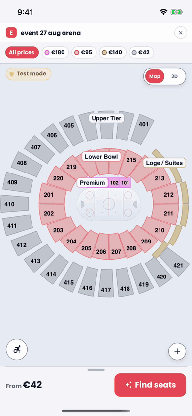

# SeatLayer SDK for React Native and Expo: seat map and seat picker

[](https://github.com/seatlayer/seatlayer-react-native/actions/workflows/ci.yml)
[](https://www.npmjs.com/package/@seatlayer/react-native)
[](https://reactnative.dev/)
[](https://expo.dev/)
[](https://www.typescriptlang.org/)
[](LICENSE)

The official SeatLayer React Native seat map SDK adds an interactive seating
chart and seat picker to React Native and Expo ticketing apps on iOS and
Android. It combines live availability, best-available selection, temporary
holds and typed TypeScript APIs with React Native buyer controls around the
SeatLayer map, the same map buyers see on the web; your trusted server completes
booking. SeatLayer is seating chart and reserved-seat ticketing software built
for venues up to stadium scale.



[Walk through the picker screen by screen](docs/picker-walkthrough.md):
what the buyer sees from the venue overview to the checkout handoff, and which
parts a host can turn off, restyle, or replace.

## What SeatLayer is

SeatLayer is reserved-seat ticketing and seating software: organizers sell with hosted checkout,
a box office, door check-in and season tickets, and platforms add the same seat maps, with 3D
seat views, through the SeatLayer SDK and API. One chart drives the 2D map, the 3D venue and the
view from each seat (3D for venues up to 60,000 seats; the 2D map benchmarked at 200,000 seats).

[Website](https://seatlayer.io/) · [For developers](https://seatlayer.io/developers/) ·
[Season tickets](https://seatlayer.io/season-tickets/) · [Pricing](https://seatlayer.io/pricing/) ·
[Live demo](https://seatlayer.io/demo/)

Season tickets are in the web and server SDKs today, not in this SDK.

## Try it

- [Buyer seat-map demo](https://app.seatlayer.io/demo/play/grand-theatre) in your browser, no account needed · [All live demos](https://seatlayer.io/demo/)
- [Quickstart](https://docs.seatlayer.io/start/quickstart/): your first event and keys
- [React Native seat-map documentation](https://docs.seatlayer.io/buyer-sdk/react-native/) · [Holds and checkout](https://docs.seatlayer.io/buyer-sdk/holds-and-checkout/) · [SDK catalog](https://docs.seatlayer.io/sdk-catalog.json)
- [`@seatlayer/react-native` on npm](https://www.npmjs.com/package/@seatlayer/react-native) · [SeatLayer SDK and API overview](https://seatlayer.io/developers/)
- [Pricing](https://seatlayer.io/pricing/): test mode is free; live, the first 100 sold seats each month are free, then 10¢ down to 5¢ per sold seat, with no subscription, and purchased credits never expire.

**How it works:** the buyer picks and holds seats in your app with your public key. Your server then reads the hold, takes the payment through your own provider, and books the seats with your secret key.

More from SeatLayer:
[SeatLayer iOS seat map SDK](https://github.com/seatlayer/seatlayer-ios) ·
[SeatLayer Android seat map SDK](https://github.com/seatlayer/seatlayer-android) ·
[SeatLayer Flutter seat map SDK](https://github.com/seatlayer/seatlayer-flutter) ·
[SeatLayer AI Toolkit](https://github.com/seatlayer/seatlayer-ai-toolkit)

## Install

> **Latest release:** 0.5.0 on [npm](https://www.npmjs.com/package/@seatlayer/react-native).
> Pin the version you tested, and test your event, checkout hand-off and target
> devices before release.

### Expo

```bash
npm install @seatlayer/react-native
npx expo install react-native-webview
```

### React Native Community CLI

```bash
npm install @seatlayer/react-native react-native-webview
npx pod-install
```

React Native autolinks `react-native-webview` on Android and iOS. The package
ships no custom native module of its own, so there is nothing else to link.

On Android, let the app see the network state. With Expo, in `app.json`:

```json
{ "expo": { "android": { "permissions": ["ACCESS_NETWORK_STATE"] } } }
```

With the React Native Community CLI, beside `INTERNET` in
`android/app/src/main/AndroidManifest.xml`:

```xml
<uses-permission android:name="android.permission.ACCESS_NETWORK_STATE"/>
```

Without it the map's web view never learns that the phone went offline, so the
picker says "Updating…" where it should say "You’re offline". iOS needs nothing.

Peer requirements are `react >= 18.2.0`, `react-native >= 0.72.0`, and
`react-native-webview >= 13.0.0`. TypeScript declarations are published with the
package (`dist/index.d.ts` for ESM and `dist/index.d.cts` for CommonJS), so no
`@types/*` package is needed.

## Quick start: ready-made seat picker

Use `SeatLayerPicker` for the complete native buyer flow. Give it a definite
height or a full-screen parent, and keep the configuration object stable so
React rerenders do not reload the chart.

```tsx
import React, { useMemo } from 'react';
import { SeatLayerPicker } from '@seatlayer/react-native';

export function TicketPicker({
  event,
  startCheckout,
}: {
  readonly event: string;
  readonly startCheckout: (holdId: string) => Promise<void>;
}) {
  const configuration = useMemo(
    () => ({
      event,
      publicKey: 'pk_test_your_key',
      currency: 'USD',
      maxSelection: 8,
    }),
    [event],
  );

  return (
    <SeatLayerPicker
      configuration={configuration}
      themeMode="auto"
      onCheckout={(handoff) => startCheckout(handoff.holdId)}
    />
  );
}
```

`onCheckout` receives the typed hold handoff. Send it only to your trusted
backend for payment and idempotent booking.

## Use the lower-level seating chart

Give the map a definite height or a full-screen parent. Keep the configuration
object stable so React rerenders do not reload the chart.

```tsx
import React, { useEffect, useMemo } from 'react';
import { View } from 'react-native';
import {
  SeatLayerError,
  SeatLayerView,
  useSeatLayerController,
} from '@seatlayer/react-native';

export function SeatMapScreen({ event }: { readonly event: string }) {
  const controller = useSeatLayerController();
  const configuration = useMemo(
    () => ({
      event,
      publicKey: 'pk_test_your_key',
      currency: 'USD',
      maxSelection: 8,
    }),
    [event],
  );

  useEffect(
    () =>
      controller.on('selectionChanged', (seats) => {
        console.log('Selected seats', seats);
      }),
    [controller],
  );

  return (
    <View style={{ flex: 1 }}>
      <SeatLayerView
        style={{ flex: 1 }}
        controller={controller}
        configuration={configuration}
        onReady={(info) => {
          console.log(
            `SeatLayer ready: protocol=${info.protocolRevision} mode=${info.mode}`,
          );
        }}
        onLoadError={(error) => {
          console.error(error.code, error.message);
        }}
      />
    </View>
  );
}
```

Drive checkout-related actions through the controller:

```tsx
try {
  const hold = await controller.bestAvailable(4);
  if (hold) {
    // Send only the hold id to your trusted backend.
    await beginCheckoutOnServer(hold.holdId);
  }
} catch (error) {
  if (error instanceof SeatLayerError) {
    showInventoryMessage(error.code, error.message);
  }
}
```

For private channel inventory, mint short-lived buyer sessions on your backend
for the exact allowed origin `https://cdn.seatlayer.io`:

```tsx
const configuration = useMemo(
  () => ({
    event,
    buyerAccessTokenProvider: (context) =>
      buyerBackend.mintSeatLayerAccess(context.reason),
  }),
  [event],
);
```

## Native picker integration levels

The native picker uses one immutable latest snapshot as its seam. Choose the
integration level that matches the amount of application UI you want to own;
all three paths keep the same typed checkout handoff and capability-gated
actions.

### 1. Ready-made picker

`SeatLayerPicker` fills its bounded parent with the adaptive SeatLayer venue
map and native picker chrome.

```tsx
import { SeatLayerPicker } from '@seatlayer/react-native';

<SeatLayerPicker
  configuration={configuration}
  themeMode="auto"
  onCheckout={continueWithHandoff}
/>
```

Use `SeatLayerPickerModal` for a controlled dialog or full-screen presentation.
It uses the same scope, snapshot, and back ladder as the in-page picker.
On iOS it turns in every way your app supports; `supportedOrientations` names
other ways.

```tsx
import { SeatLayerPickerModal } from '@seatlayer/react-native';

<SeatLayerPickerModal
  visible={isPickerOpen}
  configuration={configuration}
  onCheckout={continueWithHandoff}
  onRequestClose={() => setPickerOpen(false)}
  barrierDismissible
/>
```

### 2. Customise the ready-made UI

Use typed options, theme roles, string overrides, visual style slots, and
complete-part builders to change native chrome without changing picker state or
actions.

```tsx
<SeatLayerPicker
  configuration={configuration}
  themeMode="dark"
  options={{
    layout: 'adaptive',
    chrome: { priceLegend: false },
    haptics: true,
    languages: ['en-GB', 'fr-FR'],
    pricing: {
      formatter: (amount, currency) =>
        new Intl.NumberFormat('fr-FR', {
          style: 'currency',
          currency,
        }).format(amount),
    },
  }}
  locale="fr-FR"
  strings={{ holdAndCheckout: 'Continue' }}
  styles={{
    headerContainer: { backgroundColor: '#172033' },
    continueButton: { backgroundColor: '#5B4B8A' },
  }}
  builders={{ header: ({ defaultChild }) => defaultChild }}
  onCheckout={continueWithHandoff}
/>
```

The customization layers have distinct ownership:

- `options` controls session behaviour and which ready-made parts are visible.
  `options.max3DSeats`: 3D opens for venues up to 60,000 seats; on a touch screen the default is 30,000 unless you set this option.
  `options.enable3DCrowd: false` removes the standing crowd from 3D, and
  `options.touchNavigation3D: 'classic'` keeps the earlier 3D gestures with their
  Rotate / Move control.
- `themeMode` and `themeOptions` map app colours, typography, radii, logos, and
  map colours into one resolved theme.
- `locale` selects generated native wording; `strings` overrides any individual
  label or plural formatter. `options.languages` supplies the runtime language
  choices.
- `styles` provides 62 typed, aesthetic-only slots. Colour, type, borders,
  radii, shadows, and opacity may change; SDK-owned placement, safe areas,
  viewport insets, and 44-point minimum targets remain intact.
- `builders` replaces any of 25 complete parts (28 builder keys, three of them
  alternative names) and receives the live scope plus `defaultChild`. Use a
  builder when structure or placement must change.

An app that wants the picker set in its own typeface passes
`themeOptions.theme.fontFamily` and loads the face itself (with `expo-font`,
`react-native.config.js` asset linking, or whatever the app already uses), and
every line the picker draws then takes that family. Without it the picker draws
the platform's own face, which is the right default: React Native has no
inherited text style, so a picker that guessed at the surrounding typography
would be guessing. Pass the family name the platform registers the face under,
and load every weight the app expects to see; a weight that is not loaded is
resolved to the nearest one that is.

Behaviour options worth knowing:

- `eventName` names the event in the header before the runtime reports one, so
  the title does not swap a second after the picker opens. It is never sent to
  the runtime; the runtime's own name wins the moment it arrives.
- `showBookedOverlay` (default `true`) draws the picker's own "You're all set"
  screen after your server has booked and you call `controller.markBooked`. A
  host with its own confirmation screen sets it `false`, so the buyer is told
  once.
- `showHoldPill` (default `true`) draws the header's hold countdown for as long
  as a live hold exists, whoever owns it. A host drawing its own clock sets it
  `false`. It composes with `chrome.holdPill`: the pill appears only where both
  are on.
- `chrome.showDockBar` shows the section dock bar. It is off by default on every
  width; set it to `true` to show it. The older `chrome.dock` name still works,
  and `showDockBar` wins when both are set.

Callbacks are optional observations, never a place the SDK waits:
`onReady` · `onChartLoad` · `onSelectionChanged` · `onSelectionValidityChanged` ·
`onHoldChanged` · `onHoldExpired` · `onBooked` · `onAccessExpired` ·
`onAccessUnavailable` · `onSelectedObjectUnavailable` · `onClosed` · `onError` ·
`onThemeResolved` · `onSectionFocused` · `onSeatSelected` · `onSeatRemoved` ·
`onSeatViewOpened` · `onSeatConfidence` · `onContinue`

`onBooked` fires once, when `controller.markBooked` has told the page that your
server booked the handed-off hold. A hold that leaves the map for another reason
is not a sale. Take a sale from your own server, never from `onBooked`.
`onSeatConfidence` is called when the buyer taps the seat-detail chip on the 3D
card. Leave it out and that detail shows as plain text.

`options.pricing.formatter` formats every native amount: confirmation, ticket
rows, GA/table tiers, peek, expanded cart, and best-available entry pricing.
Without one, amounts are written as the picker's language writes them, with the
currency's own decimals (`KWD 12,454.500`); a whole amount has none.
It changes presentation only. Runtime selection, hold totals, and the trusted
server checkout remain authoritative; the SDK never recalculates inventory
prices from display text.

**Your own prices.** Show the prices your backend charges on the price list, the
seat card and the cart, by category and by single seat:

```tsx
options={{
  pricing: {
    categories: { stalls: { base: 45, tiers: { child: 20 } } },
    objects: {
      'A-12': 60,
      'A-13': { tiers: { adult: 60, child: 30 } },
    },
  },
}}
```

A seat's own price wins over its category's. A new value reaches the open map, as
does `controller.setPricing(pricing)`. These prices are for display: charge from
your server.

**After your server has booked**, tell the picker: the map shows the seats booked,
the hold clock stops and "You're all set" opens.

```ts
await bookOnYourBackend(handoff.holdId);
await controller.markBooked({ holdId: handoff.holdId });
```

It answers false, and changes nothing, for another hold or no hold.

**Levels.** `SelectedSeat.floorId` and `levelName` name a seat's level on a chart
with two or more.

**Telemetry.** `configuration={{ event, telemetry: false }}` stops the map page
sending SeatLayer its load and error reports. `onChartLoad` is still called.

### 3. Compose a custom layout

`SeatLayerPickerScope` owns one command controller and one latest immutable
snapshot. The standalone parts below read the same scoped theme, capabilities,
presentation state, and actions.

```tsx
import { View } from 'react-native';
import {
  SeatLayerCartSheet,
  SeatLayerDockBar,
  SeatLayerFloorStrip,
  SeatLayerMapControls,
  SeatLayerPickerAccessibilityFilters,
  SeatLayerPickerChart,
  SeatLayerPickerHeader,
  SeatLayerPickerHoldCountdown,
  SeatLayerPickerScope,
  SeatLayerPickerViewModeControl,
  SeatLayerPriceLegend,
} from '@seatlayer/react-native';

<SeatLayerPickerScope configuration={configuration} themeMode="auto">
  <SeatLayerPickerHeader />
  <SeatLayerPickerHoldCountdown />
  <SeatLayerPriceLegend />
  <SeatLayerFloorStrip />
  <View style={{ flex: 1, position: 'relative' }}>
    <SeatLayerPickerChart style={{ flex: 1 }} />
    <SeatLayerPickerViewModeControl />
    <SeatLayerMapControls
      includeViewModeControl={false}
      showAccessibilityControl={false}
    />
    <SeatLayerPickerAccessibilityFilters />
  </View>
  <SeatLayerDockBar />
  <SeatLayerCartSheet
    expanded={isCartExpanded}
    onExpandedChanged={setCartExpanded}
    onCheckout={continueWithHandoff}
  />
</SeatLayerPickerScope>
```

Call `useSeatLayerPicker()` inside the scope when your own component needs the
latest snapshot, resolved theme, capability availability, presentation state,
or scoped actions.

The same scope also supports standalone confirmation and seat-view actions,
best seats, section navigation, floor selection, GA/table prompts, dense cart
lists, hold-lapse recovery, loading/error/empty states, venue 3D,
and panorama chrome. Custom ticket trays can reuse the exported
`resolveSeatLayerTicketLines` helper instead of reimplementing the ticket-line
rules: it turns cart items into lines with their section, row, seat, category,
price and quantity.

## Picker controller

`SeatLayerPickerController` carries the picker's own commands alongside the
venue-map ones. Reach it as `controller` from `useSeatLayerPicker()` inside a
`SeatLayerPickerScope`. The chrome-facing members:

| Member | What it does |
| --- | --- |
| `setSelectionFocus(seatId \| null)` | Names the seat a host-drawn card is asking about, so the runtime paints it as the candidate. `null` clears the paint. |
| `setBlockedRegions(regions \| null)` | Reports where native chrome lies over the map, in the map's own pixels, so the runtime swallows a touch that starts inside one. |
| `frameSeat(seatId, options)` | Pans (never zooms) so a seat rests in the band the reported insets leave clear. Answers `dy: 0` for a seat already in place, an unknown seat, insets that leave no band, or a stale gesture count. |
| `focusAccessibilityFilter()` | Flies to the matches of the filter already on, leaving the filter alone. |
| `focusNextAccessibleSection(types?)` | Steps to the next section holding a free matching space, in chart order, wrapping. `null` (nothing matches) is an answer; `undefined` means the runtime does not offer the tour. |
| `subscribeSeatRetap(listener)` | A seat already in the selection tapped again. Subscribing never replays an earlier event. |
| `subscribeBooked(listener)` | Fires once per sale, with the handoff that became it. |
| `getCheckoutHandoff()` / `getBookedHandoff()` | The handoff this picker made, and the one the page said is booked. |
| `releaseHandoffAndChangeSeats()` | Gives a handed-off hold back so the seats go on sale again and the buyer picks afresh. Answers `false` where there is no handoff or the runtime does not offer the reject. |
| `releasePickerOwnedHold()` | Releases a picker-owned hold after earlier queued mutations have settled. |
| `refreshAvailability()` / `holdSelection({ ttlMs })` | Re-reads live availability; holds the current selection. |

Each command is gated on what the loaded runtime advertises, and the matching
getter says so before you call: `supportsSelectionFocus`,
`supportsBlockedRegions`, `supportsFrameSeat`, `supportsAccessibilityFocus`,
`supportsAccessibleSectionTour`, `supportsHandoffReject`,
`supportsAvailabilityRefresh`, `supportsHoldSelection`. A command the runtime
does not offer resolves with nothing rather than rejecting: a capability the
runtime does not advertise is a feature this host does not offer, never a
failure.

`SeatLayerPickerBlockedRegionSurface`, `SeatLayerPickerBlockedRegion` and
`useSeatLayerPickerBlockedRegionCover` measure and report those rectangles for
you when you compose your own chrome, including the 600 ms a rectangle keeps
guarding after its control has gone.

## Optional blur behind the seat card

While the seat card is up, the map goes behind a veil with a feathered hole
around the tapped seat, so the buyer can still see the seat they are being
asked about. React Native has no blur of its own, and a native blur module
cannot be a hard dependency: a bundler resolves `require` statically, so an
app without the module could not build.

An app that already has one installs it once, at start-up:

```tsx
import { BlurView } from '@react-native-community/blur';
import { setSeatLayerPickerSpotlightBlur } from '@seatlayer/react-native';

setSeatLayerPickerSpotlightBlur(BlurView);
```

Without it the glass is the plain veil, which is a correct state and not a
degraded one. Pass `undefined` to remove it again. The picker drops the blur
and deepens the veil by itself when the buyer has asked for reduced
transparency.

## Optional vector seat glyphs

A seat can say what it is (an accessible physical seat, an empty wheelchair
space, a restricted view, a premium seat), and each of those wears a drawing
shared with every other SeatLayer SDK, so the same seat wears the same mark
everywhere. With no drawing dependency the picker draws each glyph from a small
image in the package, in the row's own color, on iOS and Android.

`react-native-svg` is an **optional peer**. An app that already has it installs
the built-in vector renderer once, at start-up, and every glyph is drawn
natively instead, scaling without resampling and taking each row's ink
directly:

```tsx
import Svg, { Circle, Path } from 'react-native-svg';
import { installSeatLayerPickerSvgIcons } from '@seatlayer/react-native';

installSeatLayerPickerSvgIcons({ Svg, Path, Circle });
```

You pass your own imports rather than the SDK requiring the module, for the
same reason as the blur above: a bundler resolves `require` statically, so a
guarded import here would put `react-native-svg` in every consumer's build
graph whether they wanted it or not. `Circle` is optional; without it the
circles in a glyph are drawn as paths. Pass `undefined` to go back to the
images, and `setSeatLayerPickerSeatIconRenderer` to draw them some other way
entirely.

## Run the example app

```bash
pnpm install
cd example && pnpm install && pnpm start
```

`example/App.tsx` is a minimal Expo app using the production ready-made picker
and secure checkout handoff. Set
`EXPO_PUBLIC_SEATLAYER_EVENT` and, for public startup,
`EXPO_PUBLIC_SEATLAYER_PUBLIC_KEY` before starting it; when the event is absent,
the example shows setup guidance and does not mount a picker. The browser-based
[buyer seat-map demo](https://app.seatlayer.io/demo/play/grand-theatre) is a preview of the
wider SeatLayer buyer experience, not a React Native app.

To build and test the package itself, see [CONTRIBUTING.md](CONTRIBUTING.md).

## Security boundary

The React Native app **selects and holds** inventory. Your trusted backend
**inspects and books** the hold after payment or order validation.

- Never ship a SeatLayer secret key in JavaScript or the app bundle.
- Send only the `holdId` and your normal checkout context to your backend.
- Calculate the charge from server-inspected hold items, not device input.
- Reuse your stable order id as the booking reference for safe booking retries.
- Do not allow arbitrary navigation from the SDK renderer.

Continue with
[seat holds and secure server-side checkout](https://docs.seatlayer.io/buyer-sdk/holds-and-checkout/)
before connecting payment and booking.

## Renderer version and origin

`SeatLayerView` shows the SeatLayer venue map, the same map as on the web,
inside your app. Each SDK release uses one matching map version, exported as
`seatLayerHostedWebVersion`. Register `https://cdn.seatlayer.io` on the
publishable key used for public startup. For private inventory, omit `publicKey`
and use `buyerAccessTokenProvider`; buyer access tokens stay in memory and are
never placed in a page URL, a React key or an event payload.

Your code never touches the map directly. It works through a typed TypeScript
controller whose contract matches the Web, iOS and Flutter SDKs: every command gets one answer, or a timeout error after 15 seconds (45 seconds for a command that can place a hold).

**Prepare the picker in advance (optional).** `SeatLayerRuntimePrewarm` fetches
the venue map files before the picker opens. The result expires after a short
time and is dropped under memory pressure.

## Commands

`hold` · `resumeHold` · `extendHold` · `release` · `releaseLabels` ·
`bestAvailable` · `holdGA` · `setSeatTier` · `getSelection` ·
`selectObjects` · `deselectObjects` · `clearSelection` · `selectCategories` ·
`deselectCategories` · `setSelectableObjects` · `setMaxSelection` ·
`getSelectionValidity` · `refreshAccess` · `getCurrentHold` · `getGAAreas` ·
`getFloors` · `setFloor` · `setColorblindSafe` · `setViewMode` ·
`getViewMode` · `zoomIn` · `zoomOut` · `zoomToFit` · `destroy`

Every command returns a promise. Failures reject with `SeatLayerError`.
Inventory outcomes such as `sold_out`, `not_enough_together`, expired holds, and
hold conflicts remain distinct codes suitable for buyer-facing recovery.

## Events

Subscribe with `controller.on(name, listener)`. The returned function removes
the listener.

```tsx
useEffect(() => {
  const offHold = controller.on('holdChanged', persistOpenHold);
  const offExpired = controller.on('holdExpired', returnBuyerToSelection);
  const offError = controller.on('error', reportSeatLayerError);
  return () => {
    offHold();
    offExpired();
    offError();
  };
}, [controller]);
```

Events: `ready` · `selectionChanged` · `holdChanged` · `holdRestored` ·
`holdExpired` · `selectionValidityChanged` · `selectionValid` ·
`selectionInvalid` · `selectionLimit` · `accessExpired` · `accessUnavailable` ·
`selectedObjectsUnavailable` · `error` · `hint` · `gaClick` · `seatHover` ·
`deckTap` · `checkout` · `unknownEvent`

Unknown future events remain observable through `unknownEvent`, so a new map
event never crashes an older app.

## Layout and lifecycle

- Use a fixed-height or full-screen parent; do not put the map inside a vertical
  `ScrollView`. The canvas owns pan and pinch for map navigation.
- Keep `configuration` stable with `useMemo`.
- Change `reloadKey` to reload the map on purpose. When the system closes the
  map's page (low memory), the picker reloads it by itself; a `SeatLayerView`
  reports an `sl_transport` error, and a new `reloadKey` loads it again.
- `useSeatLayerController` disposes the controller automatically on unmount.
- Persist an open `holdId` and call `resumeHold` after app restoration.

## Accessibility

The ready-made picker declares its own reading order, type-size ceilings, live
regions and focus handling. Two of those need something from the host app.

### iOS reading order needs a native feature flag

The picker walks a screen reader through the seat map in buyer order (event,
prices, map, then the tray) rather than in the order the views happen to be
painted. It declares that with React Native's own
`experimental_accessibilityOrder`, naming the `nativeID` of each surface at the
composition root.

**On iOS that prop is only honoured when the app turns the native feature flag
on.** Without it, nothing breaks and nothing is announced twice: VoiceOver
simply falls back to the paint order, in which the cart tray is reached before
the map. On Android the order is honoured without a flag.

Turn it on once, early in the app's native start-up, before the first React
Native view is created, in `AppDelegate`:

```objc
// AppDelegate.mm, above [super application:didFinishLaunchingWithOptions:]
#import <React/RCTConstants.h>

RCTSetAccessibilityElementOrderEnabled(YES);
```

or, in a Swift `AppDelegate`:

```swift
RCTSetAccessibilityElementOrderEnabled(true)
```

Expo apps reach the same file through a config plugin or a prebuild; a managed
project that cannot run native code does not get the declared order, and the
picker stays usable on the fallback.

Check your React Native version's release notes for the flag's exact name: it
has been an experimental API, and the SDK deliberately spreads the prop rather
than typing it, so a runtime that does not know it simply ignores it.

### Bold text and text size

`Bold Text` and the platform's text-size setting are answered by the picker
itself, with no host wiring: every weight the picker states moves up one step
(200, clamped at 900) while `Bold Text` is on, and each surface caps how far
its type may grow so a sheet cannot push its own buttons off screen. The
card's answer scales down before it truncates, and the boxes grow with the
type they hold.

### Everything else is already wired

No host code is needed for the rest, and all of it follows the platform's own
settings:

- the map is one named region with a hint naming the controls around it;
- the seat card is a dialog, with custom actions, that hides the page beneath
  it, and focus returns to the map when the card (or a toast's action) is
  done with it;
- a change that is news is a live region and nothing else is: where the buyer
  has arrived and how much room is left there, and the hold's countdown;
- reduced motion has its own routing for both settle springs, and reduced
  transparency turns the seat card's spotlight into a deeper flat veil;
- haptic cues run behind one switch, `options.haptics`, and a platform that
  refuses one is not an error the buyer sees;
- the accessibility sheet applies each switch as it is flipped, with no Apply
  step, and closes an unanswered seat card as it opens so one decision surface
  holds the screen at a time. Where the runtime advertises
  `accessibility-focus-v1`, a provision's free count is a button that turns it
  on, applies the filter and frames the first section holding a matching space,
  and a stepper beside the accessibility control walks the rest.

## Frequently asked questions

### Is there a React Native SDK for seat selection in a ticketing app?

Yes. `@seatlayer/react-native` gives React Native and Expo apps on iOS and
Android a ready-made seat picker: live availability, seat selection, best
available, holds, a cart, 3D and the view from a seat for venues up to 60,000
seats, and a checkout hand-off to your backend. The controls are React Native
components with typed TypeScript APIs, and the seat map itself is the SeatLayer
map from the web, shown inside your app. You pay only for sold seats, with 100
free every month, and the same charts run on the web, iOS, Android and Flutter.

### How do I add a seat map to a React Native app?

Install `@seatlayer/react-native` with `react-native-webview`, then render
`SeatLayerPicker` with your event key and publishable key in a full-screen or
fixed-height parent. That one component is the whole buyer flow: the live seat
map, filters, seat confirmation, cart, holds, best available, 3D for venues up
to 60,000 seats, and the checkout hand-off. Use `SeatLayerView` with
`useSeatLayerController()` only when your app draws every control itself.

### What is native in the SeatLayer React Native SDK?

The picker controls around the seat map are React Native components, and your
code works through typed TypeScript commands, payloads, errors and events. The
seat map itself is the SeatLayer map from the web, shown inside your app; the
package adds no custom native module (no podspec and no Swift, Kotlin, Java or
Objective-C source).

### How much does the SeatLayer React Native SDK cost?

Building and testing is free: test mode has no time limit, needs no card and
uses no credits. Live, you pay per sold seat: the first 100 sold seats each
month are free, then 10 cents down to 5 cents a seat, with no subscription, and
credits you buy never expire.

### Does it work with Expo?

Yes. The only required native dependency is `react-native-webview`, which Expo
Go already includes, so `npx expo install react-native-webview` is enough on a
supported Expo SDK. Development builds and bare React Native projects work the
same way, and the repository's `example/` app is an Expo app.

### How do temporary seat holds work?

When a buyer goes to checkout, the SeatLayer picker holds the seats they picked
for that buyer for a set time, which you can change per event, so no other buyer
can take them. A hold that is never booked expires on its own: `onHoldExpired`
tells your app, or the `holdExpired` event with `SeatLayerView`, where your code
calls `hold()` itself. `extendHold` and `resumeHold` cover longer checkouts and
app restarts.

### Which React Native and React versions are supported?

The package needs `react >= 18.2.0`, `react-native >= 0.72.0` and
`react-native-webview >= 13.0.0`, and it is developed and tested against React
Native 0.86 and React 19. `react-native-svg >= 13.0.0` is an optional peer: pass
it to `installSeatLayerPickerSvgIcons` to draw the seat-note marks on iOS. iOS
and Android are both supported, and the package ships ESM, CommonJS and
TypeScript declarations.

## Continue your React Native integration

- [Follow the React Native seat-map documentation](https://docs.seatlayer.io/buyer-sdk/react-native/)
  for setup, lifecycle, commands, events, and runtime requirements.
- [Connect seat holds to secure server-side checkout](https://docs.seatlayer.io/buyer-sdk/holds-and-checkout/)
  without exposing booking credentials in the app.
- [Run the complete checkout example](https://docs.seatlayer.io/examples/complete-checkout/)
  to connect the buyer hold id to payment and idempotent booking.
- [Compare SeatLayer's mobile seat map SDKs](https://docs.seatlayer.io/buyer-sdk/mobile/)
  when choosing between React Native, Flutter, and the native iOS and Android
  packages.
- [Review the buyer SDK installation options](https://docs.seatlayer.io/buyer-sdk/install/)
  when the same event also has to render on the web.
- [See how the 3D seat map works](https://seatlayer.io/3d-seat-map/): the 3D
  venue and the view from each seat, built from the same chart, on every plan,
  for venues up to 60,000 seats.
- [Point AI coding agents at the SeatLayer docs index](https://docs.seatlayer.io/llms.txt)
  (`llms.txt`) for an agent-readable map of the documentation.

## SeatLayer SDK ecosystem

| Surface | Package or source |
| --- | --- |
| React Native | [`@seatlayer/react-native`](https://www.npmjs.com/package/@seatlayer/react-native) (this package) |
| JavaScript | [`@seatlayer/js`](https://www.npmjs.com/package/@seatlayer/js) |
| React | [`@seatlayer/react`](https://www.npmjs.com/package/@seatlayer/react) |
| Vue | [`@seatlayer/vue`](https://www.npmjs.com/package/@seatlayer/vue) |
| Angular | [`@seatlayer/angular`](https://www.npmjs.com/package/@seatlayer/angular) |
| iOS | [`seatlayer-ios`](https://github.com/seatlayer/seatlayer-ios) |
| Flutter | [`seatlayer`](https://pub.dev/packages/seatlayer) |
| Android | [`seatlayer-android`](https://github.com/seatlayer/seatlayer-android) |
| Server SDKs | [Node.js, Python, PHP, Ruby, .NET, Java, and Go](https://docs.seatlayer.io/server-sdk/install/) |

## Scale evidence

Benchmarked on public 100,000-, 150,000- and 200,000-seat venue fixtures on 15 September 2026: 200,000 seats chart-ready in 1.95 s, desktop, local production build. Tested at 10,000 simulated concurrent buyers on one 12,000-seat event (18 September 2026): engine-side hold latency p99 9 ms, zero server errors. Method, fixtures and run files: https://github.com/seatlayer/seatlayer-performance. Live 200,000-seat stadium demo: https://app.seatlayer.io/demo/play/century-stadium-200k.

## License

MIT © SeatLayer
